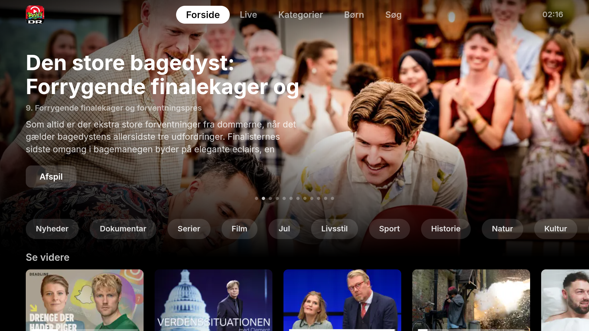
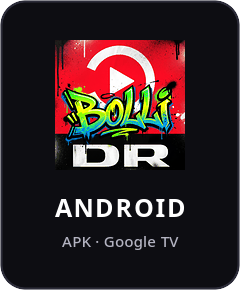
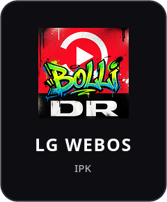

# Bolli DR

En hurtig app til DR's live-kanaler og programmer: DR1, DR2, TVA Live, DR Ramasjang og DRTV Ekstra, Forside, Kategorier, Børn og Søg, med "Se videre", "Min liste", undertekster og tilgængelighed.

Bolli DR er ikke en officiel DR-app. Programmer, billeder, navne og logoer er DR's; du logger ind med din egen DR-konto (dr.dk/aktiver).

<p align="center"></p>

Her ligger kun de færdige pakker, under [Releases](https://github.com/aktiwers/bolli-dr/releases).

<p align="center">
  <a href="https://github.com/aktiwers/bolli-dr/releases/latest/download/bolli-dr.apk"></a>
  &nbsp;&nbsp;
  <a href="https://github.com/aktiwers/bolli-dr/releases/latest/download/bolli-dr.ipk"></a>
</p>

<p align="center">Google TV og Android TV: skriv koden <b>2268953</b> i Downloader-appen, eller åbn <a href="https://aftv.news/2268953">aftv.news/2268953</a> i en browser.</p>

<p align="center">LG webOS: tilføj Homebrew-repositoryet <code>https://aktiwers.github.io/bolli-homebrew/apps.json</code> i Homebrew Channel (<a href="#lg-webos">se nedenfor</a>).</p>

## Google TV og Android TV (fx Chromecast med Google TV)

1. Installér **Downloader** (fra AFTVnews) fra Google Play.
2. Giv Downloader lov til at installere apps: Indstillinger › Apps › Sikkerhed og begrænsninger › Ukendte kilder › Downloader.
3. Åbn Downloader og skriv koden **2268953**. Kortlinket [aftv.news/2268953](https://aftv.news/2268953) eller hele adressen
   `https://github.com/aktiwers/bolli-dr/releases/latest/download/bolli-dr.apk` giver det samme.
4. Installér, og åbn **Bolli DR** under Dine apps.

En ny version installeres samme vej, oven i den gamle; login og indstillinger bliver.

Jævnest billede: sæt Google TV til **1080p 50 Hz** (Indstillinger › Skærm og lyd › Opløsning). DR sender med 50 billeder i sekundet.

Fjernbetjeningen: pilene, OK og Tilbage. Hold OK nede for mere (beskrivelse, Min liste, Se videre). Søg har en mikrofon-knap. Indstillinger › Fjernbetjening viser alle knapperne.

## LG webOS

Til LG-tv med webOS Homebrew Channel (rootet eller i udviklertilstand).

Nemmest er at tilføje mit Homebrew-repository. Så ligger Bolli DR og Bolli YouTube i Homebrew Channels liste, og nye versioner kommer der som opdateringer:

1. Åbn Homebrew Channel, og gå til Settings (tandhjulet).
2. Vælg **Add repository**, og skriv:

   ```
   https://aktiwers.github.io/bolli-homebrew/apps.json
   ```

3. Gå tilbage, og installér Bolli DR fra listen.

Eller installér IPK-filen direkte:

```
https://github.com/aktiwers/bolli-dr/releases/latest/download/bolli-dr.ipk
```
